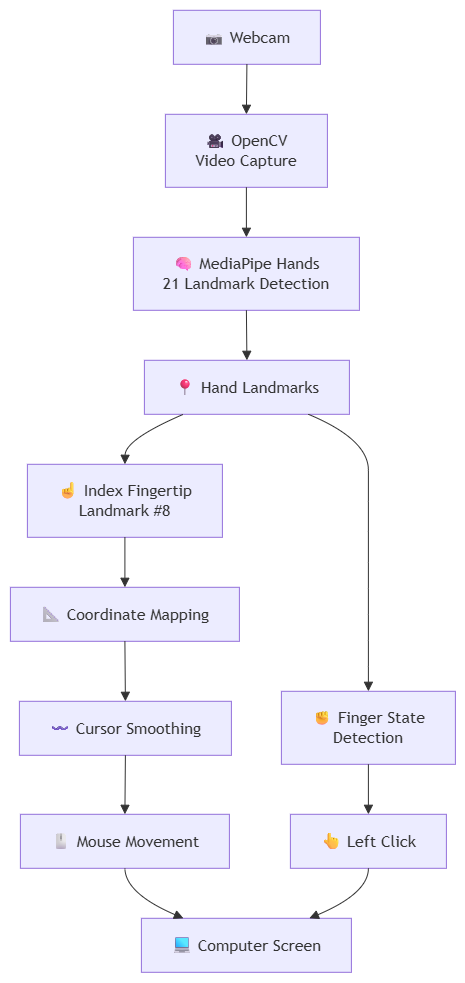
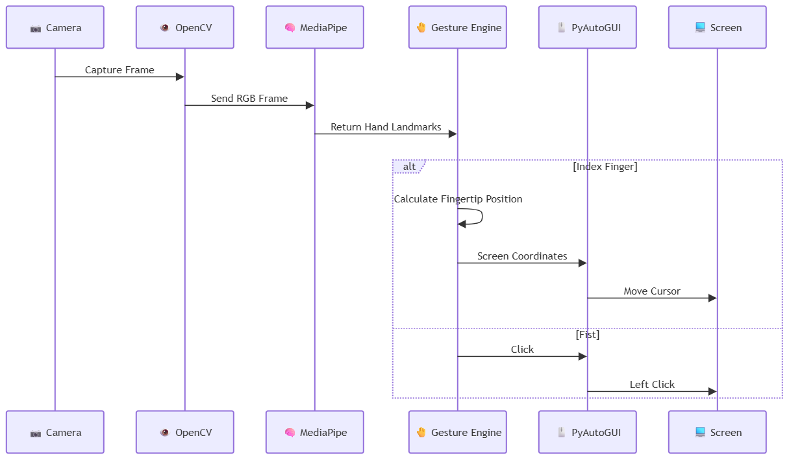
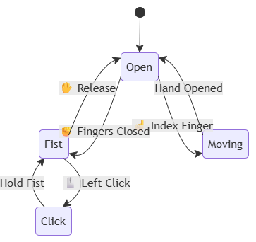
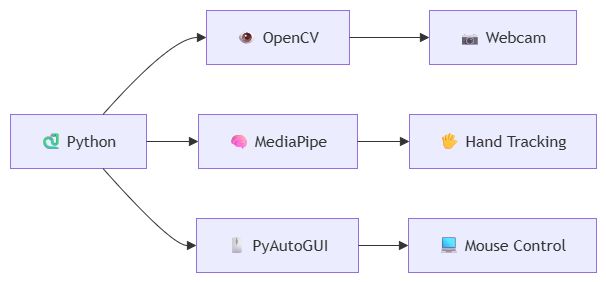
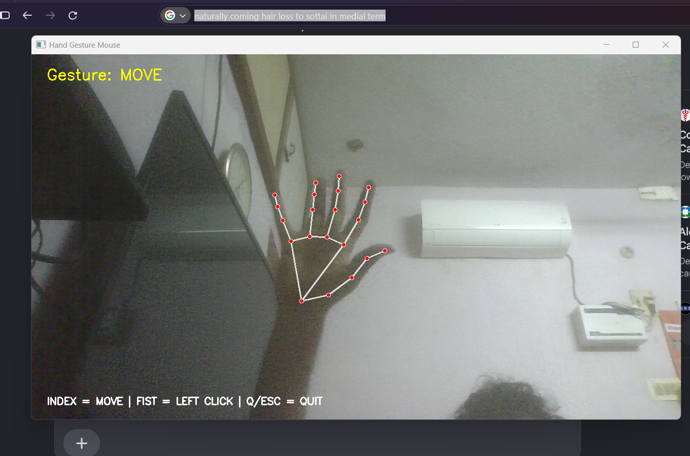
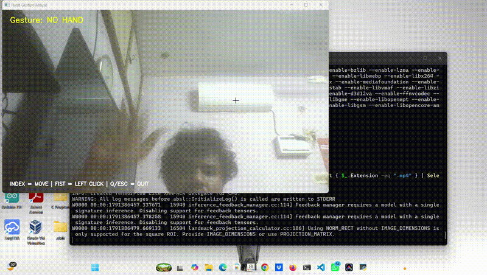

# 🖐️ Hand Gesture Mouse

<p align="center">
  
  
  
  
  
</p>

<h3 align="center">
  🖐️ Control Your Computer Mouse Using Hand Movements
</h3>

<p align="center">
  A real-time computer vision project that transforms hand gestures captured through a webcam into mouse movements and clicks.
</p>

---

## 📌 Project Overview

**Hand Gesture Mouse** is a Python-based computer vision project that allows you to control the computer mouse without physically touching a mouse.

The system uses a **PC webcam** to detect the user's hand, identifies the position of the **index fingertip**, converts its movement into screen coordinates, and controls the real mouse cursor.

A **closed-fist gesture** is interpreted as a left-click.

### 🎮 Gesture Controls

| Hand Gesture | Action |
|:---:|---|
| ☝️ Index Finger | 🖱️ Move Cursor |
| ✊ Closed Fist | 🖱️ Left Click |
| 🖐️ Open Hand | Ready for Movement |
| ⌨️ `Q` / `ESC` | Exit Application |

---

# 🧠 System Architecture

The complete architecture of the project is shown below.

<p align="center">
  
</p>

### 📐 Editable Draw.io Diagram

The original editable architecture diagram is available here:

👉 [Open hand_mouse_architecture.drawio](assets/hand_mouse_architecture.drawio)

---

# 🔄 How It Works

The system follows a real-time processing pipeline:git commit -m "Initial commit - Hand Gesture Mouse"

1. The **webcam** captures live video.
2. **OpenCV** reads and processes each frame.
3. **MediaPipe Hands** detects the hand.
4. MediaPipe extracts **21 hand landmarks**.
5. The system analyzes the landmarks to determine the gesture.
6. The **index fingertip landmark (Landmark 8)** is used for cursor movement.
7. Camera coordinates are converted into screen coordinates.
8. **PyAutoGUI** moves the operating-system cursor.
9. A closed-fist gesture generates a **left mouse click**.

<p align="center">
  
</p>

### 📐 Editable Flow Diagram

👉 [Open flow.drawio](assets/flow.drawio)

---

# ☝️ Cursor Control

MediaPipe provides normalized landmark coordinates.

The index fingertip corresponds to:

```text
Landmark 8
```

The detected fingertip position is mapped from the webcam coordinate system to the computer screen coordinate system.

```text
Camera Coordinates

(0,0)
 ┌──────────────────────────┐
 │                          │
 │          ☝️              │
 │          ●               │
 │       Landmark 8         │
 │                          │
 │                          │
 └──────────────────────────┘
             ↓
      Coordinate Mapping
             ↓
Screen Coordinates

(0,0)
 ┌────────────────────────────────────┐
 │                                    │
 │                 🖱️                 │
 │                                    │
 │                                    │
 │                                    │
 └────────────────────────────────────┘
```

The basic mapping concept is:

```text
Camera X,Y
    │
    ▼
Normalize / Scale
    │
    ▼
Screen X,Y
    │
    ▼
PyAutoGUI
    │
    ▼
Mouse Cursor
```

---

# ✊ Fist Click Detection

The system detects a closed-fist gesture using the relative positions of the hand landmarks.

A click is generated when the hand changes from an open/ready state to a closed-fist state.

The system also maintains a click state to prevent continuous clicking while the fist remains closed.

### Example

```text
☝️ Open / Index Finger
        │
        ▼
   Move Cursor
        │
        ▼
✊ Closed Fist
        │
        ▼
   LEFT CLICK
        │
        ▼
☝️ Open / Ready
        │
        ▼
     Continue
```

<p align="center">
  
</p>

### 📐 Editable Click Detection Diagram

👉 [Open click_detection.drawio](assets/click_detection.drawio)

---

# ⚙️ Technology Stack

<p align="center">
  
</p>

### 📐 Editable Technology Stack Diagram

👉 [Open technology_stack.drawio](assets/technology_stack.drawio)

| Technology | Purpose |
|---|---|
| 🐍 **Python** | Core programming language |
| 👁️ **OpenCV** | Webcam capture and image processing |
| 🧠 **MediaPipe** | Real-time hand landmark detection |
| 🖱️ **PyAutoGUI** | Operating-system mouse control |
| 📐 **Python Math** | Distance and coordinate calculations |

---

# 🧪 Real-Time Processing Pipeline

```text
┌──────────────────────────────────────────────────────────┐
│                     📷 WEBCAM                            │
│                  Capture Live Video                      │
└────────────────────────────┬─────────────────────────────┘
                             │
                             ▼
┌──────────────────────────────────────────────────────────┐
│                     👁️ OPENCV                            │
│                Capture Video Frame                       │
└────────────────────────────┬─────────────────────────────┘
                             │
                             ▼
┌──────────────────────────────────────────────────────────┐
│                    🧠 MEDIAPIPE                          │
│               Detect Hand Landmarks                      │
└────────────────────────────┬─────────────────────────────┘
                             │
                             ▼
                  ┌─────────────────────┐
                  │ 🤚 GESTURE          │
                  │    CLASSIFICATION   │
                  └──────────┬──────────┘
                             │
                  ┌──────────┴──────────┐
                  ▼                     ▼
           ☝️ INDEX FINGER          ✊ FIST
                  │                     │
                  ▼                     ▼
          📐 Coordinate             🖱️ LEFT
             Mapping                  CLICK
                  │
                  ▼
             〰️ Smoothing
                  │
                  ▼
           🖱️ Mouse Movement
                  │
                  ▼
             💻 COMPUTER
```

---

# 🔬 Technical Concepts Demonstrated

```text
Computer Vision
      │
      ├── Image Capture
      ├── Frame Processing
      └── Hand Tracking
              │
              ▼
Machine Learning
      │
      └── Hand Landmark Detection
              │
              ▼
Geometry
      │
      ├── Coordinate Systems
      ├── Distance Calculation
      └── Gesture Classification
              │
              ▼
Human-Computer Interaction
      │
      └── Gesture → Computer Input
              │
              ▼
Operating System Automation
      │
      └── Mouse Control
```

---

# 📊 Processing Flow

The overall processing sequence is:

```text
Webcam
   ↓
Video Frame
   ↓
OpenCV
   ↓
MediaPipe Hand Detection
   ↓
21 Hand Landmarks
   ↓
Gesture Recognition
   │
   ├───────────────┐
   ↓               ↓
Index Finger     Closed Fist
   ↓               ↓
Coordinate       Left Click
Mapping
   ↓
Smoothing
   ↓
Mouse Movement
   ↓
Computer Screen
```

---

# 🖥️ Project Screenshot

<p align="center">
  
</p>

The screenshot shows the project running with the webcam-based hand tracking and mouse-control system.

---

# 🎥 Demo

The following GIF demonstrates the project operating in real time.

<p align="center">
  
</p>

### 🎮 Demo Controls

```text
☝️ Index Finger
       ↓
🖱️ Move Cursor


✊ Closed Fist
       ↓
🖱️ Left Click


Q / ESC
       ↓
❌ Exit Application
```

---

# 🚀 Installation

## 1️⃣ Create / Clone the Project

Open the project folder in VS Code.

```powershell
cd F:\hand_mouse_project
```

---

## 2️⃣ Create a Virtual Environment

```powershell
python -m venv .venv
```

Activate the environment:

```powershell
.venv\Scripts\activate
```

After activation, the terminal should show:

```text
(.venv)
```

---

## 3️⃣ Install Dependencies

```powershell
pip install -r requirements.txt
```

### Recommended Environment

| Component    | Version                   |
|--------------|---------------------------|
| Python       | 3.11+                     |
| OpenCV       | 4.11.0                    |
| MediaPipe    | 0.10.21                   |
| PyAutoGUI    | Latest compatible version |

---

# ▶️ Run the Project

Start the application:

```powershell
python hand_mouse.py
```

Your webcam window should open.

The system will then detect your hand and allow you to control the mouse.

---

# 🎮 Controls

```text
        ☝️
   Index Finger
        │
        ▼
   🖱️ Move Cursor


        ✊
   Closed Fist
        │
        ▼
   🖱️ Left Click


      Q / ESC
        │
        ▼
  ❌ Exit Application
```

---

# 📁 Project Structure

```text
hand_mouse_project/
│
├── .venv/
│
├── assets/
│   ├── click_detection.drawio
│   ├── click_detection.png
│   ├── demo.gif
│   ├── flow.drawio
│   ├── flow.png
│   ├── hand_mouse_architecture.drawio
│   ├── hand_mouse_architecture.png
│   ├── screenshot.png
│   ├── technology_stack.drawio
│   └── technology_stack.png
│
├── hand_mouse.py
├── README.md
└── requirements.txt
```

---

# 🗂️ Diagram Files

All major system diagrams were created using **draw.io**.

| Diagram | PNG Preview | Editable Source |
|---|---|---|
| System Architecture | [View PNG](assets/hand_mouse_architecture.png) | [Open Draw.io](assets/hand_mouse_architecture.drawio) |
| Processing Flow | [View PNG](assets/flow.png) | [Open Draw.io](assets/flow.drawio) |
| Click Detection | [View PNG](assets/click_detection.png) | [Open Draw.io](assets/click_detection.drawio) |
| Technology Stack | [View PNG](assets/technology_stack.png) | [Open Draw.io](assets/technology_stack.drawio) |

---

# 💡 Key Features

- ✅ Real-time hand tracking
- ✅ Webcam-based computer vision
- ✅ 21-point hand landmark detection
- ✅ Index-finger cursor control
- ✅ Closed-fist left-click detection
- ✅ Coordinate mapping between camera and screen
- ✅ Mouse control using PyAutoGUI
- ✅ Real-time gesture recognition
- ✅ Click-state handling to prevent repeated clicks
- ✅ Draw.io system architecture documentation
- ✅ Demonstration GIF included
- ✅ Project screenshot included

---

# 🔮 Future Improvements

Possible improvements include:

- 👆 Right-click gesture
- ✌️ Double-click gesture
- 🤏 Scroll gesture
- 🤌 Drag-and-drop gesture
- 🔊 Gesture-controlled volume
- 🖱️ Improved cursor smoothing
- 🎯 Adaptive sensitivity
- 👋 Multi-hand gesture support
- ⚡ Performance optimization
- 🧠 Machine-learning-based custom gesture classification

---

# 👨‍💻 Author

**Siddarth**

Electronics & Communication Engineering  
Embedded Systems | Firmware | IoT | Computer Vision

---

## ⭐ Project

A computer-vision-based Human-Computer Interaction project that demonstrates how natural hand movements can be converted into real-time computer input using a standard webcam.